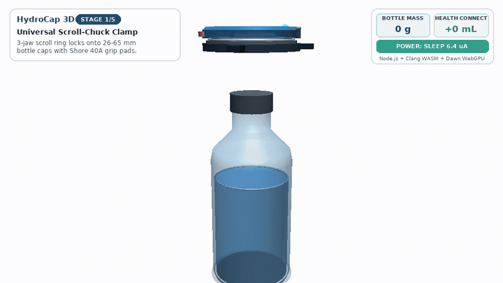
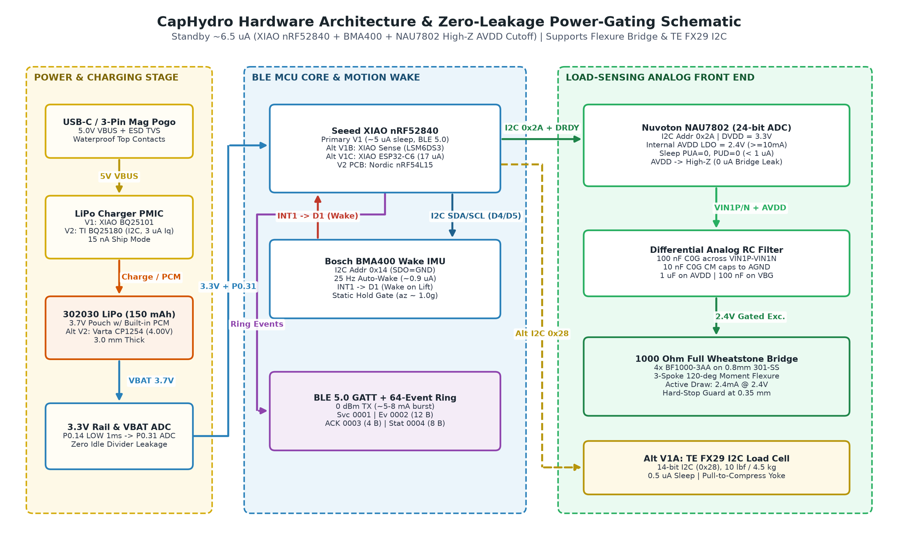
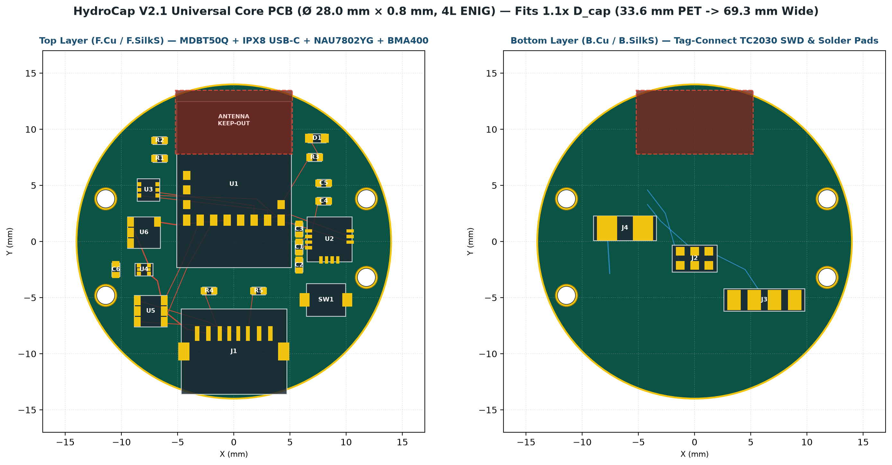
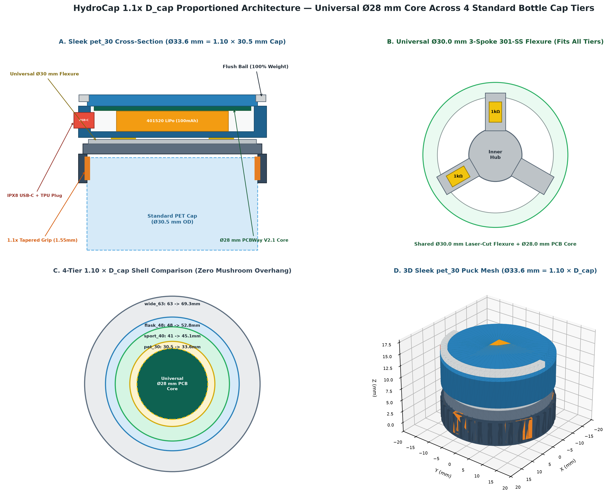
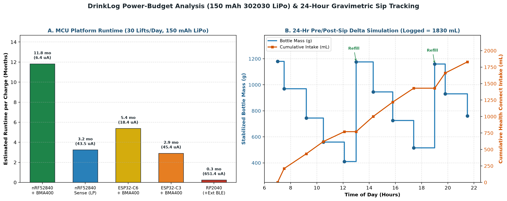

# 💧 HydroCap — Concept Universal Waterproof BLE Smart Bottle-Cap Hydration Tracker

<p align="center">
  
</p>

<p align="center">
  
  
  
  
  
  
  
  
</p>

> [!NOTE]
> **Concept & Reference Design:** HydroCap is currently a **pre-prototype hardware and software concept**. No physical PCB, enclosure, strain-gauge flexure, or live BLE/USB-C unit has been fabricated or bench-tested yet. All power budgets, mechanical tolerances, PCBWay deliverables, firmware modules, and companion code are validated in software/simulation only (`C++17` unit tests, `pytest`, programmatic DRC/STL/DXF checks, and Dawn WebGPU/WASM + Three.js renders). Review KiCad footprints, RF antenna clearance, IP67 seal compression, and mechanical fits before ordering prototype hardware.

**HydroCap** is a conceptual, ultra-thin (`11.0 mm` added cap height), rechargeable, **IP67 waterproof USB-C** smart bottle-cap gripper proportioned at **`1.10 × D_cap`** (`33.6 mm` for standard PET water bottles up to `69.3 mm` for wide-mouth flasks) around a **universal `Ø 28.0 mm` drop-in PCBWay core** designed to measure fluid consumed from **pick-up / put-down gravimetric weight differences** and log every sip into **Android Health Connect** (`HydrationRecord`).

Everything needed to review, simulate, and prototype the concept — **3D-printable STLs**, **laser-cut flexure DXF**, **PCBWay Gerber/BOM/CPL & KiCad 8 files**, **firmware**, **Node.js + Clang `wasm32` + Native Dawn WebGPU animation (`webgpu-dawn-wasm/`)**, **interactive Three.js viewer (`web-threejs/`)**, and **BLE/Health Connect companion code** — lives in this repository.

---

## ✨ Key Highlights

* 📐 **`1.10 × D_cap` Zero-Overhang Proportions:** Instead of a bulky universal puck overhanging a small PET bottle, HydroCap scales cleanly across 4 standard cap tiers (`33.6 / 45.1 / 52.8 / 69.3 mm`) while sharing **one universal `Ø 28.0 mm` PCBWay PCBA + `Ø 30.0 mm` 301-SS flexure core** across all 4 shells:
  | Tier Preset | Bottle Type | Nominal Cap OD (`D_cap`) | HydroCap OD (`1.10 × D_cap`) | Battery |
  | :--- | :--- | :---: | :---: | :---: |
  | **`pet_30`** *(Default)* | Standard PET Water / Soda (`28 mm` neck) | `30.5 mm` | **`33.6 mm`** | `401520` (`100 mAh`, ~`8.0 mo`) |
  | **`sport_40`** | Sports / Wide PET (`38 mm` neck) | `41.0 mm` | **`45.1 mm`** | `302030` (`150 mAh`, ~`11.8 mo`) |
  | **`flask_48`** | Insulated Standard Flask | `48.0 mm` | **`52.8 mm`** | `302030` (`150 mAh`, ~`11.8 mo`) |
  | **`wide_63`** | Wide-Mouth Hydro Flask / Nalgene | `63.0 mm` | **`69.3 mm`** | `302030` (`150 mAh`, ~`11.8 mo`) |
* ⚖️ **Moment-Cancelling 3-Spoke Flexure:** Universal **`Ø 30.0 mm × 0.8 mm`** laser-cut `301-SS` flexure with `4× BF1000-2AA` (`1000 Ω`) full Wheatstone bridge and `0.35 mm` drop hard-stops rejects off-axis tilt moments and twisting torque.
* 🔋 **8–12 Months per Charge (`6.4 µA` Standby):** `NAU7802YG` (`QFN-16`) switches its internal `2.4 V AVDD` LDO to **High-Z** between lifts (`0 µA` bridge leak), paired with a `0.9 µA` **Bosch BMA400** wake-on-lift IMU.
* 🔌 **Waterproof USB-C Charging + Dual Debug:** Uses an **Amphenol `12402448E512A` IPX8 mid-mount USB-C** port + captive `TPU 85A` plug + **Raytac `MDBT50Q-1MV2` (`nRF52840`)** for native USB 2.0 CDC serial calibration (`s`, `t`, `c <g>`, `d`, `b` UF2/DFU) AND a zero-height bottom **Tag-Connect `TC2030` SWD** footprint.
* 🏭 **Turnkey PCBWay Ready:** Full KiCad 8 project (`Ø 28.0 mm`, `0.8 mm` 4L ENIG), RS-274X Gerbers + Excellon drills, matching 1:1 BOM & Centroid CPL CSVs, `Ø 30.0 mm` sheet-metal DXF, and 8 split 3D-printable STLs.

---

## 🧩 Hardware Components & Architecture

<p align="center">
  
</p>

<details>
<summary><b>🔬 1. Physics & Gravimetric Sensing Mechanics (Why Cap-Lift Works)</b></summary>

1. **Cap-Lift Load Path (`100%` Bottle Mass):** When a bottle rests on a desk, its cap carries zero load. HydroCap embeds a **flush-folding finger bail** on the upper housing; lifting the bottle by the bail routes `100%` of gravity through the `0.8 mm` flexure between the upper puck and lower cap clamp.
2. **Pre-Drink vs. Post-Drink Delta:** Because screw caps are removed while drinking, each stabilized lift records $m_k$:
   $$\Delta V_{\text{mL}} = \frac{m_{k-1} - m_k}{\rho_{\text{water}}}, \qquad \rho_{\text{water}} \approx 1.00\text{ g/mL}$$
   * **$\Delta m \ge +15\text{ g}$:** Logged as **fluid consumed** (`delta_ml > 0`).
   * **$\Delta m \le -25\text{ g}$:** Classified as a **bottle refill** (`delta_ml = 0`, baseline updated).
   * **`|m| < 45 g` (Unscrew Auto-Tare):** When the cap is unscrewed, firmware gently tracks zero offset (`0.8 * old + 0.2 * median`), eliminating thermal drift.
3. **Inertial & Tilt Compensation:** When `BMA400` detects a steady vertical hold (`a_z ∈ [0.85g, 1.15g]`, tilt `< 15°`), upward hand acceleration is removed via $m = F_z / a_z$.

</details>

<details>
<summary><b>🛒 2. Emoji-Tagged Component Matrix & Multi-Variant BOM (<code>docs/BOM.csv</code>)</b></summary>

| Emoji | Subsystem | Primary Component (V2 PCBWay / V1) | Key Specs & Role | Links |
| :---: | :--- | :--- | :--- | :--- |
| 🧠 | **MCU + BLE** | **Raytac `MDBT50Q-1MV2`** (`nRF52840`) *(V1: Seeed XIAO nRF52840 / ESP32-C6)* | Native USB 2.0 `D+/D-` + SWD + BLE 5.0 (`~5 µA` idle; chosen over `nRF54L15` which lacks native USB PHY) | [`BOM.csv`](docs/BOM.csv) |
| 🔌 | **Waterproof USB-C** | **Amphenol `12402448E512A`** + `USBLC6-2SC6` + `2× 5.1kΩ` | IPX8 mid-mount O-ring USB-C, ESD/TVS protection, CC1/CC2 5V negotiation | [`PCBWAY_ORDER_GUIDE.md`](hardware/pcbway/PCBWAY_ORDER_GUIDE.md) |
| 🔋 | **Charger & LDO** | **TI `BQ25180YBGR`** + **`TPS7A0233PDBVR`** + **`302030` 150 mAh LiPo** | `15 nA` ship mode, I²C programmable `VBATREG`, `25 nA` 3.3V LDO, `3.0 mm` pouch | [`DESIGN_SPEC.md`](docs/DESIGN_SPEC.md) |
| 📡 | **Wake IMU** | **Bosch `BMA400`** (`I2C 0x14`) | `0.9 µA` at `25 Hz` auto-wake interrupt (`INT1 -> D1`); validates vertical hold | [`sensor_drivers.h`](firmware/include/sensor_drivers.h) |
| ⚖️ | **24-bit Bridge ADC** | **Nuvoton `NAU7802SGI`** (`I2C 0x2A`) | Internal `2.4 V AVDD` LDO goes **High-Z** in sleep (`0 µA` bridge leak) | [`circuit_pinout_v1.md`](hardware/netlist/circuit_pinout_v1.md) |
| 📏 | **Strain / Load Cell** | **`4× BF1000-3AA` (`1000 Ω`)** on `0.8 mm` `301-SS` flexure *(Alt: TE `FX29` I²C)* | `2.4 mA` active bridge draw (`3×` lower than `350 Ω` cells); `0.35 mm` hard-stop | [`09_flexure_3spoke_0p8mm_301SS.dxf`](cad/stl_print_parts/09_flexure_3spoke_0p8mm_301SS.dxf) |
| 🐛 | **Debug Header** | **Tag-Connect `TC2030-IDC-NL`** (Bottom Pads) + `SW1` DFU button | Zero added thickness 6-pin SWD + UART pogo interface | [`HydroCap_V2.kicad_pcb`](hardware/pcbway/kicad/HydroCap_V2.kicad_pcb) |

*Note: **Adafruit SHT4x Trinkey (`ATSAMD21E18`)** has no BLE/battery support and **RP2040/Pico W** leaks `~500–1500 µA` in sleep (~4–10 days battery); see [`docs/DESIGN_SPEC.md`](docs/DESIGN_SPEC.md) for the full 7-board power benchmark.*

</details>

<details>
<summary><b>🌊 3. Waterproof IP67 USB-C Charging & Dual Debug Architecture</b></summary>

* **2-Layer Waterproofing:**
  1. **Connector Seal:** `Amphenol 12402448E512A` mid-mount IPX8 USB-C receptacle seals directly against the enclosure perimeter lip, backed by a captive **`TPU 85A` port plug** (`08_usbc_waterproof_plug_tpu.stl`) to block soap/grit during bottle washing.
  2. **Housing Seal:** Top lid compresses a **`Ø 58 × 1.5 mm` silicone O-ring** into the upper puck gland; flexure leads pass through a `4.0 mm` **neutral-cure silicone RTV** gland in the hub plate.
* **USB-C Live Debug & Calibration CLI (`0 µA` Unplugged Penalty):**
  Plug into any PC with a standard USB-C cable (`115200` baud) while `ENABLE_USB_DEBUG_CLI=1` in [`main_nrf52.cpp`](firmware/src/main_nrf52.cpp):
  * `s` → JSON telemetry (`uptime_s`, `vbat_mv`, `last_g`, `zero`, `cpg`, `pending`)
  * `t` → Tare unweighted cap offset
  * `c 500` → Two-point calibration with a known `500 g` weight
  * `d` → Dump queued offline hydration events
  * `b` → Reboot directly into **UF2/DFU USB-C bootloader**
* **Hardware SWD Recovery:** Bottom-side **Tag-Connect `TC2030-IDC-NL`** pads expose `VDD_3V3`, `SWDIO`, `nRESET`, `SWDCLK`, `GND`, `UART_TX` without adding vertical height.

</details>

---

## 🏭 PCBWay Fabrication, PCBA & 3D Printing Package

<p align="center">
  
</p>

<p align="center">
  
</p>

<details>
<summary><b>📦 4. Ready-to-Upload PCBWay Order Files (Gerbers, KiCad 8, BOM, CPL, Laser DXF)</b></summary>

| Service | File(s) to Upload | Key Order Settings |
| :--- | :--- | :--- |
| **PCB Fabrication** | [`hardware/pcbway/fab/HydroCap_V2_PCBWay_Gerbers.zip`](hardware/pcbway/fab/HydroCap_V2_PCBWay_Gerbers.zip) | `4 Layers`, `Ø 42.0 mm`, **`0.8 mm` thick**, **ENIG-RoHS** |
| **Turnkey PCBA** | [`HydroCap_V2_PCBWay_BOM.csv`](hardware/pcbway/pcba/HydroCap_V2_PCBWay_BOM.csv) + [`HydroCap_V2_PCBWay_CPL_PickAndPlace.csv`](hardware/pcbway/pcba/HydroCap_V2_PCBWay_CPL_PickAndPlace.csv) | **Top-side SMT only** (`17` SMT parts; `J2/J3/J4` marked `PCB_PAD_DNP`) |
| **KiCad 8 Source** | [`hardware/pcbway/kicad/`](hardware/pcbway/kicad/) (`HydroCap_V2.kicad_pro/.kicad_sch/.kicad_pcb`) | Generated & verified via [`generate_pcbway_package.py`](hardware/pcbway/generate_pcbway_package.py) |
| **Sheet Metal Laser** | [`cad/stl_print_parts/09_flexure_3spoke_0p8mm_301SS.dxf`](cad/stl_print_parts/09_flexure_3spoke_0p8mm_301SS.dxf) | **`0.8 mm` 301 Stainless Steel (Full Hard)**, laser cut |

Full step-by-step instructions: [`hardware/pcbway/PCBWAY_ORDER_GUIDE.md`](hardware/pcbway/PCBWAY_ORDER_GUIDE.md).

</details>

<details>
<summary><b>🖨️ 5. Split 3D-Printable STL Parts (<code>cad/stl_print_parts/</code> &amp; <code>universal_cap_gripper.scad</code>)</b></summary>

| STL / CAD File | Qty | Material | Description |
| :--- | :---: | :--- | :--- |
| [`01_scroll_collar_knurled_u65.stl`](cad/stl_print_parts/01_scroll_collar_knurled_u65.stl) | 1 | PA12 / PETG | Outer knurled scroll ring (`26–65 mm` cap OD) |
| [`02_chuck_hub_plate_u65.stl`](cad/stl_print_parts/02_chuck_hub_plate_u65.stl) | 1 | PA12 / PETG | Concentric 3-jaw carrier w/ `4 mm` RTV wire gland |
| [`03_gripper_jaw_x3.stl`](cad/stl_print_parts/03_gripper_jaw_x3.stl) | **3** | PA12 / PETG | Sliding clamp jaws |
| [`04_jaw_grip_pad_tpu_x3.stl`](cad/stl_print_parts/04_jaw_grip_pad_tpu_x3.stl) | **3** | **TPU 85A** | High-friction bottle-cap grip pads |
| [`05_upper_puck_housing_usbc_ip67.stl`](cad/stl_print_parts/05_upper_puck_housing_usbc_ip67.stl) | 1 | PA12 / PETG | Houses `Ø 42 mm` PCB, `302030` LiPo, IPX8 USB-C bezel & O-ring groove |
| [`06_top_waterproof_lid.stl`](cad/stl_print_parts/06_top_waterproof_lid.stl) | 1 | PA12 / PETG | O-ring compression lid + 4× M2 countersunk screws |
| [`07_folding_finger_bail.stl`](cad/stl_print_parts/07_folding_finger_bail.stl) | 1 | PA12 / CF-PETG | Flush-folding bottle-lift bail |
| [`08_usbc_waterproof_plug_tpu.stl`](cad/stl_print_parts/08_usbc_waterproof_plug_tpu.stl) | 1 | **TPU 85A** | Secondary captive IP67 USB-C washdown plug |
| [`universal_cap_gripper.scad`](cad/universal_cap_gripper.scad) | — | OpenSCAD | Parametric source (`universal_65` / `compact_45`, `flexure_3spoke` / `fx29_yoke`) |

Full 3D assemblies are also exported as color-coded `.glb` / `.stl` in [`cad/outputs/`](cad/outputs/).

</details>

---

## 💻 Firmware, Power Model & Google Health Connect App

<p align="center">
  
</p>

<details>
<summary><b>⚡ 6. Firmware Targets, BLE GATT Binary Protocol &amp; Pipeline</b></summary>

* **Pipeline Flowchart:** [`hardware/diagrams/firmware_ble_pipeline.png`](hardware/diagrams/firmware_ble_pipeline.png) (Draw.io XML audited to `0` overlaps)
* **PlatformIO Environments ([`firmware/platformio.ini`](firmware/platformio.ini)):**
  * `xiao_nrf52840_bma400` *(Primary V1 / V2 `MDBT50Q`: `6.4 µA` sleep → **~11.8 months** on `150 mAh` LiPo)*
  * `xiao_nrf52840_sense` *(Onboard `LSM6DS3TR-C` w/ gyro OFF `CTRL2_G=0x00` → **~3.2 months**)*
  * `xiao_esp32c6_bma400` *(Budget `~$6` MCU w/ `RTC_DATA_ATTR` state retention & Wi-Fi off → **~5.4 months**)*
* **BLE GATT Service (`7a4b0001-3c9e-4f1a-9b2d-8e5c10293847`) + Battery Service `0x180F`:**
  * `0002` **Event Notify/Read (`12 B`, `<IIhH`):** `uint32 seq`, `uint32 uptime_s`, `int16 delta_ml`, `uint16 bottle_mass_g`
  * `0003` **ACK Write (`4 B`, `<I`):** `uint32 last_acked_seq` (clears 64-event non-volatile ring buffer)
  * `0004` **Status Read (`8 B`, `<IHH`):** `uint32 device_uptime_s`, `uint16 vbat_mv`, `uint16 last_mass_g`

</details>

<details>
<summary><b>📱 7. Android Health Connect (<code>HydrationRecord</code>) &amp; Python BLE Bridge</b></summary>

Because legacy Google Fit APIs reach end-of-service in late 2026, [`companion/android-health-connect/`](companion/android-health-connect/) writes directly to on-device **Android Health Connect**:
* [`BleGattProtocol.kt`](companion/android-health-connect/src/main/java/com/caphydro/app/BleGattProtocol.kt) — Little-endian packet codec & offline timestamp reconstruction (`sipEnd = now - (deviceUptimeS - ev.uptimeS)`).
* [`HealthConnectSyncManager.kt`](companion/android-health-connect/src/main/java/com/caphydro/app/HealthConnectSyncManager.kt) — Inserts `HydrationRecord(volume = Volume.milliliters(...))` with idempotent `clientRecordId = "caphydro-$mac-$seq"`.
* [`CapHydroBleClient.kt`](companion/android-health-connect/src/main/java/com/caphydro/app/CapHydroBleClient.kt) — Writes BLE ACK (`0003`) **only after** Health Connect confirms persistence.
* [`companion/python-ble-bridge/cap_ble_receiver.py`](companion/python-ble-bridge/cap_ble_receiver.py) — Desktop `bleak` receiver + `--simulate` binary loopback test.

</details>

---

## 🧪 Verification & Quickstart Commands

```bash
# 1. Native C++17 Firmware DSP, Auto-Tare, Inertial & Ring-Buffer Unit Tests
g++ -std=c++17 -Wall -Wextra -Werror -Ifirmware/include \
  firmware/tests/test_hydration_core.cpp -o /tmp/test_hydration_core && /tmp/test_hydration_core

# 2. Render 3D Animation via Node.js + Clang wasm32 + Native Dawn WebGPU (Zero Browser)
cd webgpu-dawn-wasm && npm run build:wasm && npm run build:hud && npm run render && cd ..
# Keyframe sheet saved to outputs/hydrocap_dawn_webgpu_keyframes.png

# 3. OR Launch Interactive Three.js WebGL Browser Viewer
node web-threejs/serve.mjs --port 8080

# 3. Generate PCBWay Gerbers, KiCad 8 Files, BOM/CPL, CAD STLs/DXF & Diagrams
python hardware/pcbway/generate_pcbway_package.py
python hardware/diagrams/generate_diagrams.py
python cad/generate_cad_assets.py
python cad/export_print_parts.py

# 4. Run Python Protocol, Power Model & Manufacturing Package Integrity Tests
python companion/python-ble-bridge/power_budget_model.py
python companion/python-ble-bridge/cap_ble_receiver.py --simulate
pytest -v companion/python-ble-bridge/tests/
```
